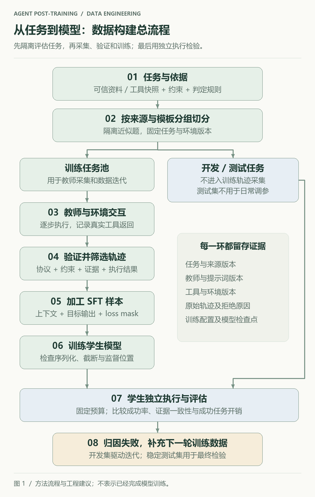
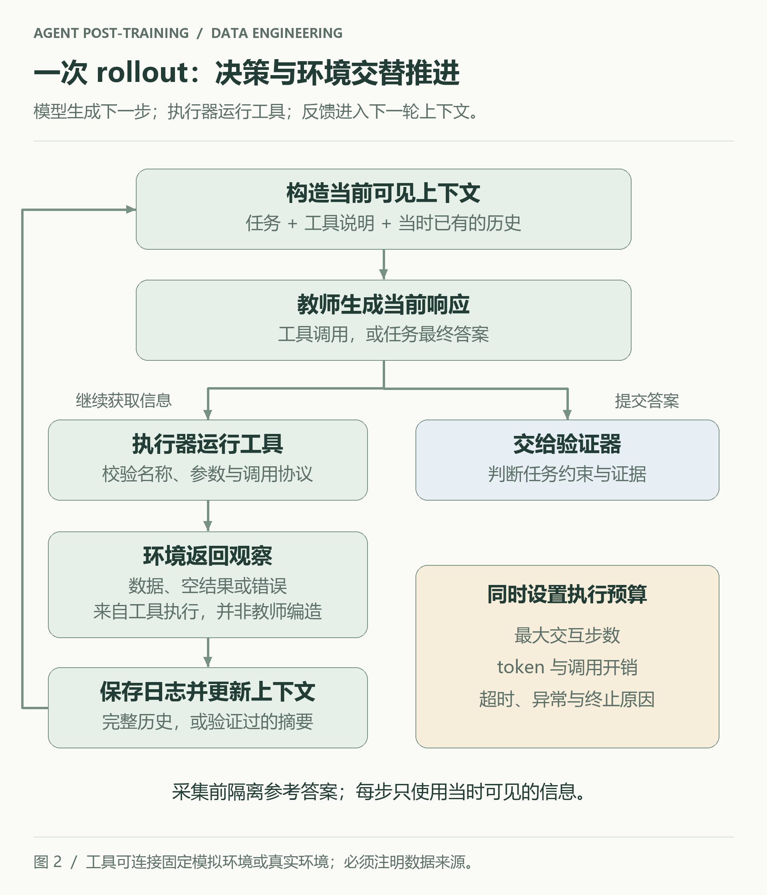
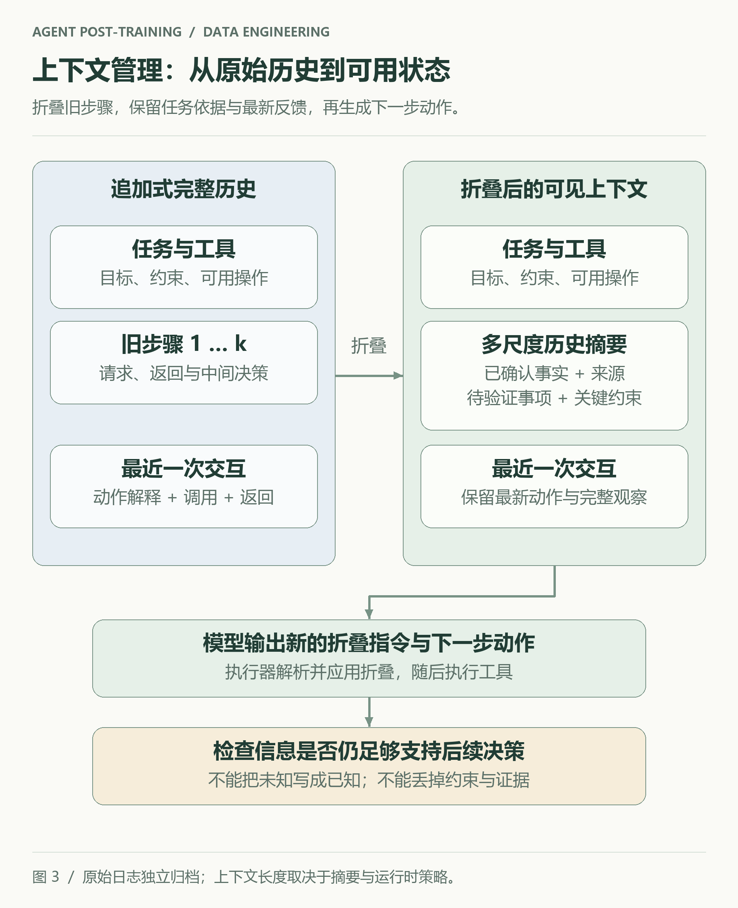
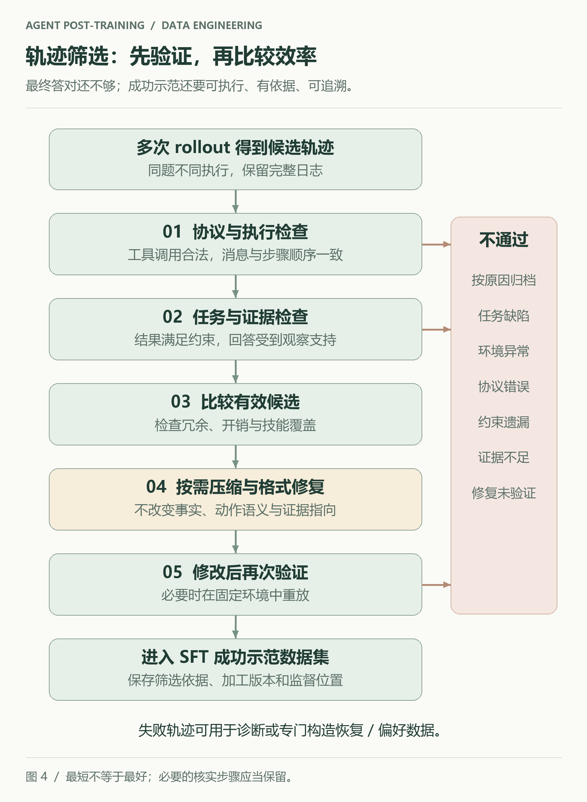

给一个旅行 Agent 这样的任务：

> 周六从 A 城到 B 城，10:30 前到达，单程预算不超过 300 元。找出可行车次，说明选择依据。

如果训练数据只有“问题 → 推荐车次”，模型能模仿最终回答的写法，却没有看到：应该先查询什么、怎样处理无票结果、在哪里检查到达时间，以及什么情况下可以结束任务。

把数据展开成一次实际执行，学习目标才变得具体：

```text
读取日期、出发地、目的地和预算
  → 查询车次
  → 接收查询结果
  → 排除晚到、超预算或无票的候选
  → 必要时补充查询
  → 给出有依据的推荐
```

**Agent 后训练的数据工程，要把这种“在反馈中继续决策”的过程，整理成模型可以学习的样本。**

本文从一份《Agent 后训练学习》思维导图展开，重点讨论工具型 Agent 的 SFT 数据构建。原图中的任务合成、教师 rollout、轨迹后处理和上下文管理构成主线；验证、切分、评估与版本管理是本文补充的工程建议。涉及研究方法时附上原始来源。全文的车次、工具响应、JSON 和数量配置都是教学示例，没有实际查询车票，也不代表已经完成模型训练或取得效果提升。

## 1. 先看全流程：数据来自任务与环境的共同作用

[](pipeline.svg)

*图 1：从任务到模型的完整流程。评估任务在教师采集训练数据前隔离；失败分析用于提出下一轮数据需求。点击图片可查看矢量图。*

这条管线至少产出五种不同的东西：

| 产物 | 里面有什么 | 它解决的问题 |
|---|---|---|
| 任务规格 | 问题、约束、证据、判定规则、环境版本 | 到底要求 Agent 做什么 |
| 原始执行轨迹 | 每一步实际输入、输出、工具请求和真实返回 | 教师究竟怎样完成任务 |
| 验证记录 | 成功与否、证据检查、协议错误、成本 | 哪些经验值得学习 |
| SFT 样本 | 可见上下文、目标输出、监督位置 | 学生具体模仿哪些 token |
| 执行评估报告 | 固定任务上的成功率、错误类型与开销 | 学生能否独立完成任务 |

只有第一项，得到的是题库。完成第二项，得到的是交互日志。经过验证、加工和监督位置检查，日志才能成为可靠的训练数据。

这也解释了为什么“合成了一万道题”和“获得了一万条高质量 Agent 轨迹”是两个不同的进度指标。

## 2. 先定学习目标，再选择数据形态

原图把数据分为 CPT、SFT 和 RL 三类。它们可以围绕同一批任务建设，但训练时的角色不同。

| 阶段 | 常见数据形态 | 主要作用 |
|---|---|---|
| CPT：继续预训练 | 领域文本、代码、工具文档，也可以包含序列化交互 | 补充知识、表达与模式基础 |
| SFT：监督微调 | 输入上下文与目标输出，或多轮工具交互 | 学习可模仿的动作与响应方式 |
| RL：强化学习 | 任务输入、可交互环境、奖励或验证器；轨迹通常在训练中采样 | 根据执行反馈优化策略 |

这个划分描述数据如何参与训练，并不表示同一份材料只能使用一次。QA 可以用来采集 SFT 轨迹，也可以作为 RL 的任务入口；同一条工具日志也可以采用不同监督策略。

本文的目标很明确：**先让学生模型学会在一个规定好的工具环境里，连续生成可执行且有依据的下一步。**

对应到旅行案例，至少包含四项能力：

1. 从请求中提取时间、预算等约束。
2. 按工具 schema 生成查询参数。
3. 根据返回结果筛选或调整查询。
4. 在依据足够时结束，依据不足时继续获取信息。

如果希望模型在长任务中管理上下文，还要增加一项：决定哪些历史需要保留、哪些可以归纳，以及摘要应该保存什么。

## 3. 任务设计：先准备可解、可验的问题

### 3.1 一道题需要带着依据进入管线

“从 A 城去 B 城”过于宽泛。合成任务时，应当同时保存约束、可用资料和判定规则。下面是一份简化的任务记录：

```json
{
  "task_id": "travel_001",
  "question": "周六从 A 城到 B 城，10:30 前到达，单程预算不超过 300 元。",
  "resolved_date": "2026-11-14",
  "constraints": {
    "arrival_before": "10:30",
    "max_price": 300
  },
  "environment": "train_fixture_v1",
  "evidence_ids": ["timetable_snapshot_001"],
  "verifier": "available_and_meets_constraints"
}
```

这里使用固定车次快照构成教学环境。相对日期在任务生成时解析为明确日期，避免同一句“周六”在不同采集时间指向不同任务。

`evidence_ids` 和判定规则用于验证，不意味着它们都要放进模型输入。教师应当通过规定的工具获取任务信息；如果把参考答案直接提供给教师，它可能绕过本来要学习的查询过程。

对于资料检索任务，可以保存来源片段与访问时间；对于代码修复，可以保存仓库版本和测试；对于仿真任务，可以保存初始模型、参数范围和通过条件。核心要求相同：**问题有明确的成功标准，成功能由模型回答之外的依据检查。**

### 3.2 “高不确定性”需要用行为来解释

原图把“高不确定性 QA”作为任务来源。这里可以把它理解为：模型难以仅凭题面和已有记忆直接确定答案，需要通过工具逐步缩小候选范围。

例如，直接问“B 城在哪里”，未必需要多步执行；要求同时满足到达时间、票价和可用性，就更容易产生有价值的工具决策。

Tongyi DeepResearch 的技术报告讨论了从结构化关系构造问题、增加问题的不确定性，再采集和筛选训练轨迹的路径。具体构造方式依赖信息检索任务，迁移到旅行、代码或仿真环境时，需要重新定义问题结构与验证依据。[Tongyi DeepResearch 技术报告](https://arxiv.org/abs/2510.24701)

工程上，不应把“高不确定性”直接等同于越难越好：

| 情况 | 观察到的现象 | 优先处理 |
|---|---|---|
| 过于简单 | 教师几乎不用工具就能完成 | 增加需要获取的信息或组合约束 |
| 有学习价值 | 需要交互，有成功样本，也有可解释的失败 | 保留，并按技能分类 |
| 超出当前能力 | 在正常环境下反复采集仍极少成功 | 拆成子任务或另列挑战集 |
| 问题本身有缺陷 | 无解、证据矛盾、工具不提供所需信息 | 修复任务规格 |

尤其要先区分环境失败和能力不足。工具一直超时，不说明题目太难；参考答案错误，也不应归咎于教师不会推理。

### 3.3 刷新训练题库，保留稳定的评估尺子

可以用教师在一组任务上的尝试结果估计难度：

$$
\widehat{p}_{\mathrm{success}}(q)=\frac{\text{成功执行次数}}{\text{总尝试次数}}
$$

它只是特定模型、采样配置、工具环境下的经验估计。很少几次尝试不足以给题目贴上永久难度标签。

随着学生能力变化，训练池可以补充新约束、新错误类型和更长任务。固定评估集则应保留版本，支持前后比较；新增的诊断题集另外记录。若反复针对某个评估失败直接改数据，该评估集就逐渐承担了开发集的角色，最终结论还需要未用于调试的测试集。

切分最好早于轨迹采集，并按资料来源、实体关系、任务模板或项目分组。同一份资料改写出的近似问题，不宜分别进入训练集与测试集。

## 4. 教师 rollout：让轨迹在真实反馈中产生

一次 rollout，是教师模型在规定环境里执行一次任务，直到结束或触发预算上限。它可以表示为：

$$
\tau=(c_1,y_1,o_1,c_2,y_2,o_2,\ldots,c_T,y_T)
$$

其中，$c_t$ 是该步实际提供的上下文，$y_t$ 是教师生成的响应，$o_t$ 是执行工具后返回的观察。最后一步可以是最终答案，不再产生工具返回。

[](rollout.svg)

*图 2：教师负责生成决策，执行器负责运行工具。采集日志需要记录这两个边界。*

旅行案例中的一次示意交互如下：

```text
教师动作：query_train(date="2026-11-14", origin="A", destination="B")

工具返回（固定测试环境）：
  T101：09:50 到达，280 元，有票
  T102：11:20 到达，210 元，有票
  T103：10:10 到达，320 元，有票

教师决策：
  T102 晚到，T103 超预算。
  T101 满足到达时间、预算和可用性，给出推荐及依据。
```

这里，三个车次是测试环境里的模拟记录。如果生产目标依赖实时票价和库存，数据及评估也要覆盖相应的实时环境。

不要让教师一次性编出“查询请求、工具结果、最终答案”，再把它当作实际执行日志。这样的合成对话可以用于某些格式教学，但它无法证明工具调用可执行、返回结果可信或任务真的完成。

采集时还应保存：教师版本、提示词版本、工具 schema、采样参数、步数与 token 预算、环境快照、错误事件，以及每步实际看到的上下文。只保存一份最终拼接的大文本，后续很难检查未来信息是否泄漏到了前面的步骤。

## 5. 两类轨迹：完整历史与主动上下文管理

### 5.1 ReAct：根据观察决定下一步

ReAct 将推理与动作交替组织，让模型在获得外部反馈后继续调整行动。[ReAct 原始论文](https://arxiv.org/abs/2210.03629)

在一个保留完整历史的实现中，第 $t$ 步的输入可以写成：

```text
system + 工具说明 + 用户问题
+ 前面各轮的 assistant 响应
+ 前面各轮的工具返回
```

目标输出则是当前 assistant 响应，包括工具调用，或者最后的回答。是否包含显式推理文本，取决于教师输出、学生模型协议和具体训练目标。

例如，看到车次返回后，训练样本的目标应当体现“利用已有结果检查约束，再给出决定”。它不能提前看到后续查询的结果。

完整历史便于追踪任务依据，但不断追加工具返回会增加上下文长度。尤其是网页检索，一次返回就可能含有大量与决策无关的内容。

### 5.2 上下文管理：把保留什么也变成学习目标

长任务里，模型可能已经搜索过十多个候选，却还要继续比较新候选。此时，历史中的“哪些已排除、为什么排除、哪些仍待验证”往往比所有原始页面都留着更有价值。

[](context-folding.svg)

*图 3：摘要替换模型可见的部分历史，原始日志继续归档。摘要的目标是保留后续决策所需的信息。*

AgentFold 将多尺度历史摘要与最近一次交互组合为上下文，并让模型生成折叠指令、简短动作解释和下一步行动。Fold-Generator 用教师采集并筛选这类交互对，再进行 SFT。[AgentFold 方法与数据采集](https://arxiv.org/html/2510.24699v1#S3)

下面是受这一思路启发的**简化教学格式，并非项目原生接口**：

```json
{
  "fold": {
    "step_range": [1, 4],
    "summary": {
      "confirmed": ["候选 C1 超预算，依据结果 R2"],
      "open_questions": ["候选 C2 的库存尚未确认"],
      "evidence_ids": ["R2", "R4"]
    }
  },
  "motivation": "先确认 C2 的库存，再决定是否推荐。",
  "action": {
    "name": "query_availability",
    "arguments": {"candidate_id": "C2"}
  }
}
```

把 `open_questions` 单独写出来，是一种工程设计建议，方便检查摘要有没有把“待验证”错误地改成“已确认”。字段名称本身不决定能力，运行时必须真正解析并应用折叠指令。

训练这类样本时，至少要验证三件事：

1. 被折叠的步骤存在，引用范围合法。
2. 摘要没有捏造结果、混淆对象或丢失关键约束。
3. 使用折叠后的上下文，后续动作仍有足够依据。

原图中的“上下文长度近似恒定”适合作为直观目标，不能直接当作通用保证。摘要数量和长度、最近工具返回、折叠策略都会影响上下文增长。上下文管理首先要保持任务信息，再考虑节省 token。

### 5.3 两类样本如何组合

可以用 ReAct 样本训练基本工具交互，再加入需要归纳历史的任务。是否分阶段、混合比例是多少，需要结合学生基线和任务长度验证。

不要为了增加数据量，给每条短轨迹机械插入压缩动作。这样可能让学生在不需要时也频繁压缩，增加输出负担，甚至丢掉本来可以直接使用的工具结果。

## 6. 轨迹后处理：把“执行成功”变成“值得模仿”

原图给出三个方向：拒绝采样、长度压缩、格式修复。落地时，可以把它们组织为明确的验证流程。

[](quality-gates.svg)

*图 4：正确性和可执行性先通过门槛，再考虑效率。经过改写的样本要重新验证。*

### 6.1 拒绝采样：在多次尝试中选择可信经验

对同一任务采集多条轨迹，再保留满足要求的示范。例如，教学性地尝试 4 次，可能得到：

| 轨迹 | 结果 | 处理方式 |
|---|---|---|
| A | 选择了超预算车次 | 记录约束检查失败 |
| B | 调用参数错误，未恢复 | 记录协议与恢复问题 |
| C | 查询一次，依据充分并正确结束 | 保留为成功示范 |
| D | 多次重复查询，最终答对 | 检查额外查询是否必要，再决定保留 |

这里的 4 次只是示例预算。实际次数要看采集成本、成功率和轨迹多样性。

“最终答案正确”还不够。猜中答案、引用无关证据，或在中间使用了不存在的工具结果，都可能产生不适合直接模仿的轨迹。

对于以成功行为为目标的 SFT，通常先使用验证通过的完整示范；失败轨迹可以进入诊断池。如果专门训练错误恢复，可以保留“发生可解释错误后成功修复”的轨迹；如果构建偏好数据，则需要另行定义比较单位和标签。失败日志不应未经处理就当作成功答案训练。

### 6.2 效率筛选：在正确的候选之间比较

可以把选择过程拆为两层：

```text
第一层：任务约束、执行协议、证据和结果是否通过？
第二层：在通过的轨迹里，比较开销、冗余和技能覆盖。
```

一条多花一步但核实了库存的轨迹，可能优于一条少一步却遗漏核实的轨迹。因此，不要单独按最短步数或最少 token 排序。

也不必让所有样本都收敛成唯一风格。适度保留有效的不同查询路径、恢复方式和停止策略，有助于覆盖任务变化；具体收益仍需执行评估确认。

### 6.3 长度压缩：压缩表达，保留决策依据

需要区分两件事：

- **离线改写训练目标**：清理重复表达、冗长解释，让样本更紧凑。
- **在线管理上下文**：模型在执行中输出折叠动作，改变下一步实际看到的历史。

前者不自动带来后者的能力。把长思考改成一句话，也不等于训练了主动记忆管理。

离线压缩后，要检查改写有没有改变动作理由、候选状态和证据指向。尤其不要让改写器利用整条轨迹的最终结论，为前面的动作补上当时尚不知道的信息。

### 6.4 格式修复：修完以后还要过验证

JSON 标点错误、工具名称拼写、字段类型或角色顺序，都可以先做结构检查。涉及工具语义的改动则需要更谨慎：将不存在的车次 ID 换成另一个真实 ID，已经改变了动作含义。

修改工具参数后，应在固定环境中重放并重新判断结果；若原环境无法复现，不能声称已验证这条修复轨迹。对于只改排版的样本，也至少重新检查结构与监督位置。

## 7. 从轨迹到 SFT：学生到底学哪些 token

### 7.1 同一条轨迹有两种组织方式

**方式一：完整多轮对话。** 保留用户、assistant 和工具消息，在多个 assistant 轮次上施加监督。

**方式二：按当前决策拆样本。** 每条样本提供当时可见的上下文，只监督该步 assistant 输出。这种方式便于明确表示折叠后的上下文。

两者都能表达“基于历史生成下一步”，但样本权重和 token 重复使用情况可能不同。若按步骤拆分，较早的 assistant 内容在后续样本中通常属于输入历史，不能因为角色仍是 assistant 就自动再次计入当前目标。

可以把拆分后的一个样本理解成：

```json
{
  "task_id": "travel_001",
  "step_id": 2,
  "context": [
    {"role": "system", "content": "任务规则和工具说明"},
    {"role": "user", "content": "旅行需求"},
    {"role": "assistant", "content": "上一步工具调用"},
    {"role": "tool", "content": "实际查询返回"}
  ],
  "target": {
    "role": "assistant",
    "content": "根据查询结果完成约束检查并回答"
  }
}
```

这仍是便于解释的中间表示。真正输入训练器前，要转成学生模型支持的消息和工具格式，并通过它的 chat template 序列化。

### 7.2 “只算 assistant loss”是监督策略

在本文讨论的动作模仿设置里，通常把 system、user 和工具返回作为条件，监督选定的 assistant 目标。工具结果提供决策依据，不要求学生去预测环境会返回什么。

设序列化后的 token 为 $x_1,\ldots,x_n$，用 $m_i$ 标记该位置是否需要监督：

$$
\mathcal{L}_{\mathrm{SFT}}
=-\frac{1}{\sum_i m_i}
\sum_{i=1}^{n}m_i\log p_\theta(x_i\mid x_{<i})
$$

在这一定义下，$m_i=1$ 表示目标 token，$m_i=0$ 表示只作为条件的 token；每条有效样本都需要至少一个目标 token。

```text
system / user       → 不计 loss
历史 assistant      → 拆步样本中通常不计 loss
tool response       → 不计 loss
当前 assistant      → 计 loss，含需要学习的工具调用或最终回答
```

具体保留哪些推理字段、是否训练多轮 assistant 输出，要由目标和模型协议决定。“只训练 assistant”并不是所有 SFT 的定义，也不会仅因为数据里写了 `role` 就自动实现。

训练前应抽取少量序列化样本，把 token 与 label 对照打印出来，验证：

- 工具调用字段是否真正进入监督目标。
- 工具返回是否只作为上下文。
- 被截断后是否还剩有效目标。
- 特殊标记和结束符是否符合学生模型协议。
- 当前输入是否包含本应在未来才出现的答案或结果。

特别是工具消息和特殊标记，教师和学生未必共享同一种序列化格式。迁移数据时，要转换到学生可用的协议。

### 7.3 数据混合要保留可追溯的类别

一个数据集可以同时包含基础调用、结果筛选、错误恢复、长任务和上下文管理样本。每类都保留标签，训练后才能知道哪种能力变化了。

混合比例没有通用答案。更稳妥的起点是先建立工具交互基线，再根据固定评估集暴露的问题补充目标样本，同时监测原有短任务是否退化。

## 8. 用独立执行检验数据，而不是只看 loss

训练 loss 下降，说明模型更容易预测训练目标。它没有直接回答“学生能否自己发起查询、处理返回并完成任务”。

评估时，需要把学生接入与训练协议一致的执行器，让它从问题开始独立运行。建议至少记录以下指标：

| 指标 | 需要回答的问题 |
|---|---|
| 任务成功率 | 最终结果是否满足全部约束 |
| 调用合法率 | 工具名称、参数和消息格式能否执行 |
| 证据一致性 | 回答是否受到已有观察支持 |
| 恢复能力 | 遇到空结果、超时或参数错误能否继续 |
| 成功任务的开销 | 在成功前提下用了多少调用、token 与时间 |
| 上下文管理质量 | 摘要是否保存关键事实、未决事项与来源 |

比较两次实验时，固定任务集、工具版本、预算和评判规则；若为了训练需要改了环境，另外记录变更，避免把工具改善误判为模型改善。

对于新加入的上下文管理样本，可以设计四组对照：原始学生、只用 ReAct 数据的学生、加入上下文管理数据的学生，以及使用固定摘要规则的执行系统。尽量对齐训练预算和推理预算，分别看短任务、长任务、关键事实保持和开销。

这些对照帮助回答一个具体问题：收益来自更好的模型动作、更多数据，还是运行时上下文策略的变化？没有独立执行结果时，应当把结论停留在“完成了数据与训练配置”，不写成“Agent 能力已提升”。

## 9. 首轮实践：先建立一条能够检查的小管线

如果从零开始，我会先用固定环境做一个教学规模的闭环。下面的数量只是便于启动的预算示例，没有统计保证：

1. **准备约 100 个任务。** 使用固定资料或工具快照，包含单次查询、组合约束、空结果和补充查询。
2. **先做分组切分。** 例如按来源与模板分成 60/20/20 的训练、开发和测试任务，检查跨组近似题。
3. **只对训练任务采集教师轨迹。** 每题尝试若干次，保留完整日志和失败原因。
4. **先人工审阅少量样本。** 检查是否真调用工具、验证器是否误判，以及输入是否泄漏未来信息。
5. **建立 ReAct 数据基线。** 跑通序列化、loss mask 和一次小规模 SFT，再让学生独立执行开发任务。
6. **补上目标能力。** 当失败确实来自历史膨胀或信息遗漏时，再添加长任务与上下文管理数据。
7. **冻结配置后使用测试集。** 报告成功与失败、开销和局限；小测试集只适合早期诊断。

每轮可以保留一份这样的清单：

```text
任务版本、来源分组与切分
教师版本、提示词版本、采样预算
环境与工具协议版本
原始轨迹、验证结果、拒绝原因
加工前后样本与监督位置抽查
学生训练配置与检查点
固定任务上的执行报告
```

有了这些记录，后续才容易回答：成功样本为什么变少、哪一种格式引发错误、摘要丢了什么，以及某次训练改善究竟对应哪次数据调整。

## 10. 学开源项目时，沿着数据流找入口

原图列出了 Alibaba-NLP/DeepResearch 和 LianjiaTech/Astra。它们可以作为进一步学习的线索，但本文只对照了 ReAct、DeepResearch 和 AgentFold 的原始材料，没有逐一审计这些项目当前的训练代码。

阅读任何一个项目时，可以带着同一组问题寻找入口：

| 环节 | 要在项目里找到什么 |
|---|---|
| 任务构建 | 问题、证据、答案与难度从哪里来 |
| 教师采集 | 谁维护上下文，谁调用真实工具 |
| 验证筛选 | 什么被拒绝，为什么被保留 |
| 样本加工 | 一条轨迹如何变成训练记录 |
| 模型训练 | chat template、监督位置和截断如何处理 |
| 执行评估 | 学生是否独立运行，环境与预算如何固定 |

代码仓库、模型权重、合成方法说明和完整训练数据，是不同层面的开放材料。DeepResearch 的 FAQ 明确说明其训练数据不计划公开，合成方法通过论文介绍；学习时应据实际可用材料确定复现范围。[DeepResearch FAQ](https://github.com/Alibaba-NLP/DeepResearch/blob/main/FAQ.md)

可以先选定一条样本，从任务源一路追到训练 label，再追到学生执行的结果。这个过程会把“Agent 后训练数据”变成可以检查的对象：任务规定要解决什么，环境提供可见反馈，轨迹记录决策过程，验证器筛选可信经验，SFT 把选定行为教给学生，独立评估决定下一轮还缺什么。

## 参考资料

- 《Agent 后训练学习》：本文起点，一页学习思维导图。本文重新绘制流程图并补充工程解释；原资料的作者与出处未标注，未在仓库中附带原文件。
- [ReAct: Synergizing Reasoning and Acting in Language Models](https://arxiv.org/abs/2210.03629)：推理、动作与环境观察的交替交互。
- [Tongyi DeepResearch 官方仓库](https://github.com/Alibaba-NLP/DeepResearch)与[技术报告](https://arxiv.org/abs/2510.24701)：任务合成和 Agent 训练的参考。
- [AgentFold: Long-Horizon Web Agents with Proactive Context Management](https://arxiv.org/html/2510.24699v1)：主动历史折叠、结构化上下文和 Fold-Generator 数据采集。
- [DeepResearch FAQ](https://github.com/Alibaba-NLP/DeepResearch/blob/main/FAQ.md)：训练数据与合成方法的公开边界。
