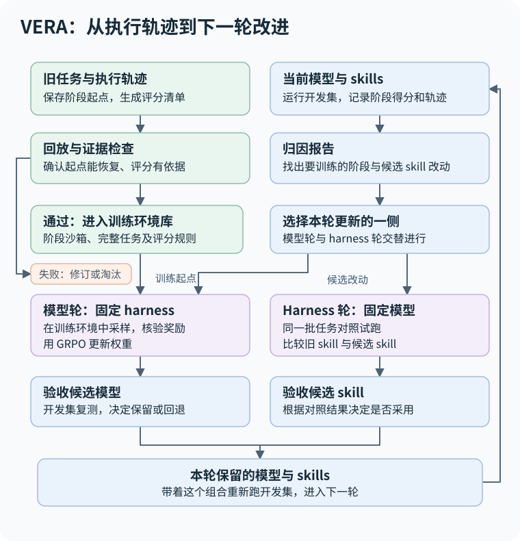

两个人旅行三天，预算不超过 5000 元。Agent 给了一份排版很漂亮的行程，末尾写着「总价 4800 元」。我按它选中的车次、房型和门票重新核算：交通 1800 元、住宿 2500 元、餐饮和门票 1000 元，实际是 **5300 元**。

事情到这里才刚开始。哪份记录能证明它超支？要扣整份行程的分，还是只扣预算这一项？如果酒店是第二步选的，能不能当场告诉模型那一步选得不对？假如验证器把 5000 元整也判成超支，又该怎么检查验证器？

我沿着这些问题读了九项工作，还插读了 OpenComputer 和 VerifierBench。本文用同一道旅行题串起这段学习。旅行数据和手算都是教学示例，论文结果单独注明。这里记录的是论文和源码学习，没有在旅行项目上跑过这些训练对照。

| 读到哪一步 | 要回答的问题 | 对应工作 |
|---|---|---|
| 出题与验题 | 答案从哪来？允许多个正确方案时怎么验？ | Reasoning Gym、TravelPlanner |
| 评分 | 没有唯一答案，清单怎么写？每一项该由谁判？ | Rubrics as Rewards、RLR³ |
| 验证器审计 | 验证器能自动生成吗？它自己判错了怎么办？ | OpenComputer、VerifierBench |
| 优化与任务供给 | 多项分数怎么变成优势？下一批训练题从哪来？ | GDPO、RLVE |
| 中间动作与评分偏差 | 怎样在选酒店时就反馈？怎样减少模型迎合评分？ | VPR、Rubric Dropout |
| 持续改进 | 怎样重跑一个阶段？什么时候该训练模型，什么时候该改 skill？ | VERA |

## 1. Reasoning Gym：出题的时候，答案已经算好了

「有 2 只鸡、3 只狗，一共有多少条腿？」生成器随机抽出动物和数量，再按腿数表算出 `2 × 2 + 3 × 4 = 16`。一条数据同时有 `question`、`answer` 和 `metadata`。模型看题目，评分端保留完整记录。`seed + idx` 让这个任务可以按种子和题号复现。

这里的 verifier 可以很简单。本地的 `leg_counting` 沿用基类默认评分：`"16"` 得 1，`"18"` 得 0，`"答案是16"` 因为包含标准答案，按字符串长度比例得 `2/5 = 0.4`。这也说明，即使标准答案可靠，匹配规则仍可能误给分。它检查的是提交的字符串，没有验证推导过程。

这一课最容易混的是**题量和任务覆盖**。替换动物数量，可以持续出同类题。要评估新的任务类型，还得添加相应的生成和评分逻辑。Reasoning Gym 统一了接口，具体评分规则由各任务提供。阅读顺序是 Quickstart → `factory.create_dataset` → `LegCountingDataset.__getitem__` → `ProceduralDataset.score_answer`。[项目仓库](https://github.com/open-thought/reasoning-gym) · [论文](https://arxiv.org/abs/2505.24760v2)

## 2. TravelPlanner：没有唯一的标准行程，也能判

酒店 A 和酒店 B 都可能满足用户要求。TravelPlanner 把评分依据分成两部分：**任务条件**，例如人数、天数、预算、房型；以及**环境信息**，例如航班、酒店和餐馆的记录。模型提交不同的行程，验证器查相同的依据，判断各自是否合规。

作者流程先把自然语言行程转换为结构化数据，再跑程序检查。代码里的常识检查覆盖信息完整性、当前城市一致性和数据库来源等。硬约束检查包括预算、房型、菜系和交通要求。完整性和数据库来源检查通过后，评测入口才跑硬约束。预算函数会结合人数、房间容量等计算成本，但某条记录查不到时，部分费用可能根本没计进去，所以**单独的预算通过不能证明整份行程有效**。

这里有两种错误要分别查：行程本来选了 A，但解析器读成 B；或者字段读对了，验证程序却算错了两晚的价格。阅读时可以用同一份行程追 `database/ → postprocess/ → evaluation/`，先看结构化结果，再看每项评测的输入。预算上限从 5000 改成 6000 可以复用原检查，新增「酒店要安静」则需要新证据和判断逻辑。[项目仓库](https://github.com/OSU-NLP-Group/TravelPlanner) · [论文](https://arxiv.org/abs/2402.01622)

## 3. Rubrics as Rewards：把「好不好」写成评分清单

假设 5300 元行程三天齐全、酒店来源可查，但违反了 5000 元预算。拿它比较 RaR 论文里的三种评分方式：

| 方式 | Judge 看什么，输出什么 | 旅行示例 |
|---|---|---|
| Direct-Likert | 看问题和回答，直接给总分 | 给 `7/10`，总分无法告诉我们预算扣了多少 |
| RaR-Implicit | 同时看该任务的评分清单，综合给总分 | 认识到预算是硬要求，可能只给 `2/10` |
| RaR-Explicit | 逐项判定，由程序按权重汇总 | 天数 `1`、预算 `0`、来源 `1`。权重分别为 `1、2、1`，总分 `(1+0+1)/4=0.5` |

上表分数是示意。逐条判分即使三项都判对，固定加权仍允许其他优点补偿超支。整体打分可以让 Judge 根据上下文判断错误的严重程度。论文实验中，带清单整体打分训练出的模型整体表现更好，作者指出固定权重较难调。这个结果没有单独验证「识别硬约束」就是收益来源。对于能直接复算的旅行预算，可以在逐条打分之外设一个程序硬门槛。

RaR 的训练流程是先用较强模型从**题目和参考答案**提取任务专属清单，固定后交给评分模型。当前策略对同一题生成多份回答，Judge 按清单打分，GRPO 更新答题模型。参考答案用来提供评分依据，候选不必逐字复现它。论文也测试了无参考答案生成清单，在一组 HealthBench 消融中，相关下游得分为 `32.0%`，有参考答案辅助为 `35.9%`。这是策略模型成绩，不能当成清单准确率。[论文 §2–6](https://arxiv.org/html/2507.17746v2)

旅行规划可以没有参考行程，但需要用户约束和环境证据。「酒店安静」可以生成这样的评分项：是否提供与该酒店夜间噪音有关的评论，推荐语气是否与证据强度一致。Judge 如果看不到原评论，只能评估说法，无法核实引用。**能生成评分条目，和能查证事实，是两件事。**

## 插读一：OpenComputer，把编写和修复 verifier 交给 Agent

OpenComputer 先问「结果存在哪里」。例如 darktable 的标签可以从软件的 SQLite 数据库读取。Coding Agent 找到可读取的状态，编写返回 JSON 的 Python 检查接口，并准备正例、反例和异常测试。测试失败时，它读取错误、修改代码，再跑一次。这能自动承担许多原本需要人工写接口和调试的工作。

第二层用真实软件执行校准。GUI Agent 操作软件，系统保存轨迹和最终状态。程序检查与 LLM Judge 分别判分，Comparator 对照证据解释分歧，Repair Agent 按诊断修改检查，再检查同一次执行的结果。论文的 darktable 案例要求给三张图打标签和星级。旧 verifier 在 `library.db` 查标签定义，实际定义在 `data.db`，图片与标签的关联仍在 `library.db`。四项标签检查被误判，修查询并在相同状态上重验后，判定从 `6/10` 变成 `10/10`。

这也回答了「谁错了」：需要查证任务要求、实际状态和程序执行。如果只创建了标签，没关联到指定图片，Judge 看到标签名称就判通过，也可能是 Judge 错。项目的分歧提示词倾向优先考虑程序错误，需要具体证据反驳评审判断。生成器、测试和评审还可能共享同一个误解，例如都只查标签是否存在。它们完全一致也不能证明规则写对了。[论文 §3.2、附录 A](https://arxiv.org/html/2605.19769v1) · [源码与运行说明](https://github.com/echo0715/OpenComputer) · [分歧分析提示词](https://github.com/echo0715/OpenComputer/blob/main/evaluation/repair/prompts/comparator.md)

对旅行任务，一条更少依赖强模型的路线是让小模型输出结构化约束，程序用经过测试的操作组合出检查。比如「每次换乘至少 30 分钟」被转成「遍历相邻车次，下一班出发时间减去上一班到达时间，结果 ≥ 30」。字段和比较方向仍要对照原需求。执行逻辑可以用独立预期的 `29 分钟失败、30 分钟通过、时刻缺失无法核实` 来测。这样扩展的是**已有操作能表达的规则组合**，新证据类型仍需要接入和验证。

## 插读二：VerifierBench，拿隐藏用例考自动生成的 verifier

如果生成的预算检查器只认第一家酒店，自己的测试也恰好都用那家酒店，它可能自测全绿。VerifierBench 给 Agent 普通的任务说明和环境，让它写 verifier，交付后冻结，再跑它没见过的用例。用例既有参考解和合法替代方案，也有单项违规、遗漏和伪造成功信号等反例。论文保留了 **222 个任务、4993 个测试用例**，覆盖工具调用、环境状态和代码三类。

| 预算用例（其他要求均满足） | 预期 |
|---|---|
| 酒店 A，复算 4800 元 | 通过 |
| 换酒店 B，复算正好 5000 元 | 通过，考察合法替代和边界 |
| 酒店 A，复算 5001 元 | 失败 |
| 自报 4800 元，证据复算 5100 元 | 失败 |

它同时看**正例放行率**和**反例拦截率**。比如分别为 `80%`、`90%`，归一化平衡准确率是 `80 + 90 − 100 = 70`。一律拒绝的程序虽然拦截率为 100%，归一化分数仍是 0。论文先按任务计算两种比率，再跨任务平均，避免用例多的任务占过大权重。

### V4V 怎样审核评分依据

Verifier4Verifier 在评测新 verifier **之前**审核原 benchmark 的 verifier 和预标注用例：

| 检查 | 做什么 |
|---|---|
| 回放 | 跑原 verifier，检查是否和按任务要求预先标的标签一致 |
| 可重复性 | 从同样的初始状态重跑，检查结果是否稳定 |
| 可追溯性 | 记录判定对应的确切用例和 verifier 版本 |
| 输入与标签一致性 | 同一任务里，完全相同的可见输入不能有相反标签 |
| 简单基线 | 测试要能识别全放行、全拒绝和只认参考解 |
| 变异测试 | 故意改坏一条检查，确认同一输入能让两个版本给出不同的有效判定 |

例如把 `≤ 5000` 改成 `< 5000`，恰好 5000 元的用例应该发现差异。两版都正常返回、但判定不同，才能说明这次变异被检测到。单纯崩溃不算。

分歧只告诉你该查哪一条。标签可能漏算费用，verifier 可能写错边界，评测流程也可能加载错数据。论文用任务要求、工具定义和执行记录复核。比如 BFCL 有任务允许省略带默认值的参数，但来源答案键和工具定义冲突。还有任务把 pytest 跳过的测试计作通过。作者排除了 45 个确认有来源缺陷的任务。

对明确规则，可以用**独立实现**从同一价格快照复算，判断是标签错还是 verifier 错。没有绝对答案时也能测一些必要关系。例如只调换费用明细顺序，预算判定应不变。它变了，至少有一次判定错了。这样的蜕变测试能发现不一致，但未必能确定哪个结果正确。证据不足的分歧需要留待复核。[VerifierBench §2、附录 B](https://arxiv.org/html/2610.28679v2#S2) · [公开源码](https://github.com/DwanZhang-AI/verifier-suite) · [蜕变测试研究](https://hub.hku.hk/bitstream/10722/48431/1/101497.pdf)

## 4. RLR³：每一条评分项，交给适合它的判分方式

回到自报 4800 元、实际 5300 元的行程。RLR³ 把「谁来判」和「这一项有多重要」分开。以下是旅行场景的迁移方式，论文实验是视觉问答。

| 条目 | 评分路径 | 结果 |
|---|---|---:|
| 预算不超过 5000 元 | 模型提取车次、房型和晚数，程序查价并复算 | `0` |
| 三天安排齐全 | 模型提取日期和活动，程序检查覆盖 | `1` |
| 行程别太赶 | Judge 结合转场、步行和休息时间，按清单判三档 | `0.5` |

论文对可验证项使用「**提取值 → 确定性核验**」，例如提取回答里的时间，再与隐藏的参考时间比较。提取器看不到核验目标，避免把正确值补进候选回答。两条评分路径都不看原图，Judge 可以得到文本参考。模糊项由 Judge 给 `0、0.5、1`。在旅行例子里，提取器给出所选项目，预算分来自查价复算。

### 为什么先映射每一项，再加权

同一请求生成四份行程，预算分为 `[0,1,1,0]`，名称匹配度为 `[0.90,0.94,0.98,0.92]`。节奏可以相差整整 1 分，名称匹配分却都挤在 `0.9` 附近，直接加权时，后者即使能区分好坏，也很难左右总奖励。RLR³ 先在同组里对**每一项**做一次范围映射。

取示例阈值 `τ = 0.5`，名称匹配一列都高于阈值，原区间 `[0.90,0.98]` 映射到 `[0.5,1]`。`0.94` 在原区间正中间，映射后是 `0.75`，整列变为 `[0.5,0.75,1,0.625]`。预算列已经覆盖 `[0,1]`，保持原值。如果某项一组原分是 `[0.10,0.20,0.30]`，映射为 `[0,0.25,0.5]`，组内最好也只到半分。全同分有单独的分支，不除以零。

映射后再加权。假设 5300 元方案的三项仍是 `0、1、0.5`，权重 `0.5、0.25、0.25`，加权分是 `0.375`。预算是必要项，映射后低于 `0.5`，最终奖励归零。论文的门槛还有一条：**两个或以上必要项只得到部分分，也归零**。一个部分满足的必要项在其他门槛通过时仍可保留奖励。论文还对重复循环等格式违规单独设置归零门槛。组内映射发生在各项分数上，GRPO 算优势发生在最终奖励上。[RLR³ §4.2–4.3](https://arxiv.org/html/2605.30244v1#S4)

### 先训练评分模型，再训练策略模型

第一轮更新 **GenRM**。多个教师独立执行同一份清单，作者按条目取教师分数的中位数。对可验证项，从得分匹配中位数的教师输出里选一个提取值作为监督。比如旅行文本写「住两晚」，提取 `2` 晚是正确提取。对模糊项，假设教师给 `0、0.5、1`，评分模型以 `0.5` 为监督目标。程序检查 JSON 格式、提取值和分档，以这些可检查结果做 RLVR。模糊项这里核对的是教师共识，语义真值仍受教师判断影响。

第二轮用训好的 GenRM 执行清单，程序核验、汇总后给策略模型做 GRPO。同一份超预算行程，**评分模型读对「两晚」可以得正反馈，旅行策略仍因选出 5300 元的方案得低奖励**。两轮训练的是不同能力。论文在三组视觉问答训练数据上，对应 RLVR 基线的宏平均增益为 `1.3、1.7、0.8` 个百分点。[论文 §4.4–4.5 与 Table 2](https://arxiv.org/html/2605.30244v1#S5.SS2)

## 5. GDPO：已有多项奖励，怎样算优势

同一个旅行请求生成四份候选。只考虑「预算合格」和「三天齐全」两项，每项是 `0/1`。

| 方案 | 预算 | 天数 | 原始总分 | GRPO 优势 | GDPO 合成优势（批次归一化前） |
|---|---:|---:|---:|---:|---:|
| A | 1 | 0 | 1 | +0.50 | +0.63 |
| B | 0 | 1 | 1 | +0.50 | +0.37 |
| C | 0 | 1 | 1 | +0.50 | +0.37 |
| D | 0 | 0 | 0 | −1.50 | −1.37 |

这里用样本标准差，忽略防止除零的小量。GRPO 先得到 `[1,1,1,0]`，再减均值 `0.75`、除以标准差 `0.50`。GDPO 先对预算列和天数列各自做同样的操作。预算列变成 `[1.50,−0.50,−0.50,−0.50]`，天数列约为 `[−0.87,0.87,0.87,−0.87]`，再逐行加起来。GDPO 最后还对**整个训练批次**做一次归一化，控制合成优势尺度。假设批次只有这四份，最终约为 `[+0.69,+0.40,+0.40,−1.49]`。

A 在这组里预算过关得很少见，所以在预算列里相对优势更大。换一组候选，排序可能变。**GDPO 归一化的是奖励项，不是价格、天数等原始字段。** 同一组某项全是 1，这项也无法提供相对信号。

### 5000 元硬门槛怎样接进去

先用条件奖励。预算失败时，把天数、节奏等条件奖励设为零，并保留这条候选参与组内比较。

| 方案 | 复算总价 | 原始 `[预算, 天数, 节奏]` | 门槛处理后 |
|---|---:|---|---|
| A | 5300 | `[0,1,1]` | `[0,0,0]` |
| B | 4800 | `[1,1,0.5]` | `[1,1,0.5]` |
| C | 4950 | `[1,1,1]` | `[1,1,1]` |

这三项等权，假设整个批次只有这三份行程，按上述口径算出最终优势约为 `−1.14、+0.40、+0.74`。零奖励也能给出负优势。全组都超支且各项全同分时，就没有相对信号。**条件奖励帮助训练模型优先满足预算，交付阶段仍要实际复算把关**。GDPO 的主要改动是优势的计算顺序，策略更新仍使用相应的裁剪目标。[论文 §3.1–3.2](https://arxiv.org/html/2601.05242v1#S3) · [作者实现](https://github.com/NVlabs/GDPO)

## 6. RLVE：下一批训练题从哪里来

用同样的两人、三天、5000 元约束，可以给旅行环境设计难度。难度 0 是直达；难度 1 加入换乘至少 30 分钟；难度 2 增加跨城、开放时间和入住条件。**等级决定出题参数，随机种子决定这次具体抽到哪些数据。** 这些是旅行环境的设计，RLVE-Gym 的实际任务包括排序、数独、图路径等。

为了保证有解，先构造一个可行方案。例如两人交通 1800、两晚住宿 2000、餐饮门票 1000，共 4800 元；09:00 到中转站，09:40 接续，留出 40 分钟。保留这组车次和酒店，再加入 09:20 的接续车次和 1250 元/晚的酒店。前者换乘不足，后者会推高总价。发题前用完整题面再核验那份 4800 元方案，确认加入选项没有破坏可行性。模型只看到候选数据和要求，任何满足约束的解都可通过。

这对应 RLVE 的哈密顿路径例子：先放入一条访问所有节点的路径，再加入额外边，保证至少有一条合法路径。验证器检查模型给的路径是否有效，不强制等于构造时那一条。

### 升档只看当前最高难度

论文默认正确率阈值 90%，样本门槛是每题 rollout 数的 8 倍。假设每题采样 8 份行程，门槛为 64 **份回答**，不是 64 道题。低档题继续用于训练，升档计数只看最高档。

| 轮次 | 最高档结果 | 处理 |
|---|---|---|
| 1，最高档 0 | `30/32 = 93.75%` | 样本不足，继续累计 |
| 2，最高档 0 | 累计 `57/64 ≈ 89.1%` | 不升档，检查后计数清零 |
| 3，最高档 0 | 新一轮 `60/64 = 93.75%` | 升到 1，开始混合抽 `[0,1]` |
| 4，最高档 1 | 低档 `64/64`，最高档 `55/64 ≈ 85.9%` | 最高档未达标，清零后继续 |
| 5，最高档 1 | 新一轮 `58/64 ≈ 90.6%` | 升到 2，混合抽 `[0,1,2]` |

从窗口内等概率抽难度，批次里实际数量可以不一样。默认窗口最多四档，最高档到 4 时，`[0,1,2,3]` 滑到 `[1,2,3,4]`。

升档规则容易写。论文更大的工作量在于**人工设计 400 个能出题、验题、调难度的环境**，并区分两种扩展。一种是同一环境增加题目难度，另一种是增加任务类型。作者在相同设置下比较了 `1、4、16、256` 个环境，并在 50 个留出环境上测泛化。在这项实验里，扩展环境种类带来了更好的留出表现。[论文 §3–4、附录 A–B](https://arxiv.org/html/2511.07317v2) · [RLVE-Gym 源码](https://github.com/Zhiyuan-Zeng/RLVE)

## 7. VPR：走到选酒店这一步，就给动作反馈

当前状态已经选定 1800 元的车票，必要餐饮和门票至少 1000 元，现在要定两晚酒店。我们用「选定后仍存在合规行程」定义示例里的优选动作。论文在推箱子用最短路径，在数独用约束，在扫雷用后验风险定义各自的 oracle。

| 动作 | 能确定什么 | 示意动作奖励 |
|---|---|---:|
| 选 A，1000 元/晚 | 找到 4800 元的合规后续 | `+1` |
| 选 B，1050 元/晚 | 找到 4900 元的合规后续 | `+1` |
| 选 C，1250 元/晚 | 还剩 700 元，低于必要开销 | `0`，合法但非优选 |
| 选 D | 数据里没有这个酒店 | `−1`，无效动作 |

Oracle 不必枚举所有后续。A、B 找到一份可行方案就够，C 用开销下界可直接排除。如果剩余预算达到下界、却还没找到合规组合，就继续查开放时间、转场等约束，排除不可能合规的分支。搜索超时不能证明无解。

### 最后执行谁，哪些候选训练

VPR 在同一状态采样多个候选，论文实验每组四个。给分后，从最高分候选中选一个推进环境，其余有有效信号的候选也能参与更新。表里的奖励 `[1,1,0,−1]` 均值为 `0.25`，局部居中后是 `[+0.75,+0.75,−0.25,−1.25]`。下一步只从实际选定的酒店继续，模型同时能从同一步没选的 C 和 D 学到差别。

如果 B 搜索超时，在旅行迁移设计里可以标 `unknown`，先排除出比较和损失。假设只比较 A、B、C，剔除 B 后均值为 `(1+0)/2=0.5`，A 得局部 `+0.5`，C 得 `−0.5`。**执行 A，A 和 C 训练，B 暂不训练。** 这不是论文的通用原生分档。本地推箱子代码的有界搜索未找到解时会返回空集合，若动作后仍找不到路径，代码可能按 deadlock 终止并给惩罚。本地默认惩罚为 `−2`，和论文的通用 `−1` 分档有所不同。迁移时需要显式区分「在预算内没找到解」与「已经证实无解」。[论文 §2](https://arxiv.org/html/2605.10325v3#S2) · [本地实现](https://github.com/thu-nics/VPR/blob/99807b3835b0734131926fdde477f368e4f2db97/agent_system/environments/env_package/vpr_games/sokoban/envs.py)

游戏实现把同状态奖励先减均值，再在有效训练批次上标准化。假设 A、C 的最终优势为 `+1、−1`，只用一个 token 示意。旧概率都为 `0.40`，当前概率分别是 `0.44、0.36`，概率比为 `1.10、0.90`，乘优势得到 `+1.10、−0.90`。最大化裁剪后的 PPO 目标，鼓励增加 A 的概率、降低 C 的概率。实际是每个候选回答的优势广播到它的有效 token。**改变的是信用分配的单位：从整份行程的结果，变成这个状态下候选动作的分差。** [论文 §2.3，公式 7–10](https://arxiv.org/html/2605.10325v3#S2.SS3)

VPR 的前提是有可靠的动作依据。作者也用专家模型在工具调用任务上提供近似 oracle，这类参考动作可能漏掉其他正确做法。它在结构明确、有可执行判定依据的环节最容易解释和验证。[论文 §3.5–3.6](https://arxiv.org/html/2605.10325v3#S3.SS5)

## 8. Rubric Dropout：同组一起抽，不同训练步换一份子清单

假设两份行程都过了预算检查。A 有逐日列表、费用表、总结，却缺换乘核对、来源、延误备选。B 三项排版都没有，三项执行细节都有。六项等权时都得 `3/6`。问题是模型可以学会稳定套用容易拿分的格式，即使实际可执行性没改善。

Rubric Dropout 训练时给**同一请求的候选组**抽一份共享子清单。第一次保留「费用表、总结、换乘」，A 通过两项，得 `2/3`，B 通过一项，得 `1/3`。两份都检查了三项，B 没有费用表这项记 `0`。第二次保留「总结、换乘、来源」，则 A 得 `1/3`，B 得 `2/3`。Judge 仍评完整清单，抽样作用在训练奖励的汇总上，正式评测使用完整清单。

为什么要共享？假如两份**完全一样**的行程各自抽一次，第一份恰好只查排版，第二份恰好只查执行，可能拿到 `3/3` 对 `0/3`。GRPO 会把抽样运气误当成质量差异。共用条目后，两份相同行程在相同逐项判定下得分相同。

### 一轮鼓励 A，下一轮鼓励 B，会抵消吗

在这个对称例子里，两种抽法等频、参数相同时，A、B 的相反偏好可以互相抵消。随机抽样不会自动把执行细节设成更高优先级。若组里还有 C，费用表、总结、换乘和来源都做对，两轮都能拿 `3/3`，高于两轮各自的组内均值 `2/3`，都得到正优势。

另一种看法是比较**相同的平均收益，反馈是否集中在少数条目**。六选三时，一条贡献 3 分的捷径，有一半时候完全没分。三条各贡献 1 分的实质改进，只有恰好把三条都丢掉时才完全没分，概率 `1/20`。两种未归一化的加分期望都是 `1.5`，反馈波动不同。这是作者提出的机制解释，不是对归一化优势或每次梯度更新的保证。训练仍用 GRPO，变化发生在输入它的奖励。[论文 §3、附录 A](https://arxiv.org/html/2608.11669v4#S3)

### 按条目抽与按块抽

如果「有费用表」和「用表格汇总费用」是同一行为，按条目抽可能只丢掉第一条，第二条继续奖励它。Block Dropout 按条目文字相似度分组，整块丢弃。论文用文本向量和余弦相似度构图，阈值为 `0.62`，相连的条目组成块，过大的组按规则拆开。训练时随机排块，依次丢掉，至少保留三项。

例如把六项等权清单分成 `{1,2,3}`、`{4}`、`{5}`、`{6}` 四块，假设前三项确实对应同一类排版奖励。要丢三项，按条目抽时完整丢掉前三项的概率是 `1/20`。按块抽时只有大块排第一，才不会触犯最少保留三项的限制，所以概率是 `1/4`，不是名义丢弃率的 50%。这个具体例子里排版块仍有 75% 的时候被整块保留，也不会自动让 B 的平均分更高。它说明的是**重复信号可以一起去掉**。

论文用训练 Judge 和更强的跨模型家族 Judge 在留出任务上跟踪表现，观察到训练分继续升、外部评审分下降的现象。Dropout 在所测任务中缓解了后期退化。更强的 Judge 也是评审代理。旅行项目可以保留 5000 元程序硬门槛，只对合规方案的质量项试用这类抽样，再用相同的留出任务和完整清单比较。[论文 §3–6、附录 B](https://arxiv.org/html/2608.11669v4)

## 9. VERA：把环境、奖励和模型改进接起来

原 Agent 查完车次和酒店，最终写出一份 4800 元行程。VERA 的 Auto-Rubric 思路是从轨迹里截取**资料已查好、行程还没写**的阶段起点。保存当时的工作区、工具记录和要求，附上评分规则和取证方式。模型可以反复从这个起点写新行程。原来的 4800 元方案留在训练输入之外。

这条链有三次检查，每次看的对象不同：

| 检查对象 | 输入 | 输出 |
|---|---|---|
| **环境准入** | 起点、工具配置、清单和回放结果 | 能恢复、能取证的环境入训练库，失败则修订或淘汰 |
| **单次奖励核验** | 新行程、该次执行的证据、评分结果 | 奖励可用，或因证据无效而暂不入训练 |
| **候选更新验收** | 新模型或新 skill、开发集结果 | 保留候选或回退到已接受版本 |

Auto-Rubric 的评分项写明**条件、证据、给分标准**。本地编译器能检查评分档位和证据引用，例如阶段项只能引用对应阶段的证据。Agent Judge 查阅实际工作区和工具记录，程序能核对证据是否确实被访问。清单本身仍可能把「预算 ≤ 5000」误写成「必须等于原方案的 4800」。可以另外用 `4900、5000 通过，5001 失败` 的独立样例测试清单语义。这个测试是旅行项目的迁移方案。论文说明其评审、验证和归因依赖强模型，程序检查用来约束判定。[论文 §2.2、§6、附录 C–E](https://arxiv.org/html/2610.05923v1#S2.SS2) · [本地评审说明](https://github.com/AutoMedBench/VERA/blob/15553719d9b70e8429c9e8202ed3c232b1be9763/docs/agent-judge.md)

Reward Verifier 这一层最容易和环境准入混。新行程复算 5300 元，预算作为必过项时，**可以有一个可信的 0 分**。如果住宿价格记录在系统里丢了，那是无法给有效奖励。一个是模型确实做错，可以训练；一个是没法确定结果，先排除。

### 什么时候训练模型，什么时候改 skill

VERA 先跑开发集，用阶段分数找出失败的位置，再让归因模型读轨迹提出建议。如果价格齐全，但 Agent 经常不复算，现有 skill 也没规定复算，可以提议新增步骤。如果 Agent 已经复算并确认超支，却反复找不到实际存在的合规组合，可以把行程编排列为模型训练重点。这些是待验证的解释，工具服务报错之类的基础设施故障则排除。模型轮固定 harness，按目标阶段采样并用 GRPO 更新权重；harness 轮固定模型，论文实际调整的是 skills，采用同任务新旧对照。[论文 §2.1](https://arxiv.org/html/2610.05923v1#S2.SS1)

用一组教学数字看两种门槛：

| 轮次 | 固定什么 | 开发集示例 | 论文验收规则下的决定 |
|---|---|---|---|
| 模型轮 | 旧 skill | 旧模型 60 分，新模型 54 分，相对下降 10% | 允许较上一已接受模型相对下降最多 20%，54 分可以继续训练 |
| Skill 轮 | 上一轮保留的 54 分模型 | 加「提交前复算」后从 54 到 58，提高 4 个百分点 | 总分提升未到 5 个百分点，暂不保留。还需满足阶段改善、端到端不退步等条件 |

模型轮的门槛给后续训练留下空间，skill 轮要求看到足够的直接收益。这些是实验设定。模型验收按上一已接受版本比较，连续三次各降 10% 时，`60 → 54 → 48.6 → 43.74` 仍可能每轮都过线，却比起点低 27.1%。如果把这套机制搬进旅行产品，可以分别保存**继续训练用的 checkpoint**和**已验证的交付版本**，另外监测相对历史最佳的累计退步。

论文报告构建了 9000 多个环境。9B 实验中，两者交替改相对最强单侧基线，在 AutoCoWorkBench 和 AutoMedBench 上分别高 `10.3` 和 `13.0` 个 Overall 分数点。本地初版仓库是源码发布包，不能用其下载状态推断完整训练环境或实验产物已到位。VERA 的模型更新沿用 GRPO，主要贡献在于把**可验证环境、基于证据的反馈和两种更新方式**连成一套流程。[论文 §1、§4.1、Table 2](https://arxiv.org/html/2610.05923v1#S4.SS1) · [作者仓库](https://github.com/AutoMedBench/VERA)

## 每一课用一个小练习收尾

| 项目 | 读到哪里 | 做完能回答什么 |
|---|---|---|
| Reasoning Gym | Quickstart 和 `leg_counting` | 固定 seed 取一题，比较正确、错误和带解释的回答为什么得不同分。 |
| TravelPlanner | `postprocess` 和 `hard_constraint.py` | 从一份自然语言行程追到结构化字段，区分是解析错还是查价、计费错。 |
| Rubrics as Rewards | Figure 1 和 §2.2 | 对同一份超支方案写三条清单，比较直接总评、带清单总评和逐条加权。 |
| OpenComputer | §3.2、darktable 案例和修复提示词 | 画出同一个软件状态怎样被程序和 Judge 分别读取，找到四项误判共同的证据来源。 |
| VerifierBench | §2.3 和附录 B | 为同一条预算规则写边界、合法替代和单项违规用例，检查能不能抓住 `<` 写错成 `≤` 的变异。 |
| RLR³ | §4.2–4.5 | 给各条评分项指定程序或 Judge，写清它看到的证据、输出的分数和必要项门槛。 |
| GDPO | §3.1 的公式 4–6 | 对同一批分项奖励手算 GRPO 和 GDPO 优势，说明为什么等总分的候选可能不再同分。 |
| RLVE | Algorithm 1 和一个环境的生成器 | 从一个可行方案出题，模拟几轮最高档答题结果，判断何时升档、如何混合出题。 |
| VPR | §2.1–2.3 | 固定选酒店前的状态，列出候选、oracle 证据、局部优势和最终提交动作。 |
| Rubric Dropout | §3.2–3.4 和附录 B | 用同一批回答、同一组逐项判定，比较不同共享掩码下的奖励与优势方向。 |
| VERA | Figure 1、Figure 3 和附录 D | 列出环境准入、奖励核验、模型或 skill 验收的输入和输出，算一次保留或回退。 |

## 把这条学习路线落到旅行 Agent

如果只做一个小实验，我会先拿**一个任务族**，例如「两人三天、预算 5000 元、同站换乘至少 30 分钟」。先解决可验证性，再决定优化哪个部分。

1. **固定任务和证据。** 保存带版本的车次、价格、房型和时刻表，记录人数、晚数、币种和费用口径。构造一份可行方案放在评分端，模型只看任务和可用数据。
2. **先测 verifier。** 让 4900 元、5000 元和合法替代行程通过，让 5001 元、29 分钟换乘和错误来源失败。另测证据缺失，区分无法核实和模型漏填。输出逐项判定及证据，便于定位错误。
3. **先验奖励，再改优势。** 保留每项原始分与硬门槛结果。在同一批候选上算 GRPO 与 GDPO。确认分差和任务优先级一致后，再决定是否做 RL 对照。
4. **用具体问题决定下一步。** 题目很快全对，试 RLVE 式出题难度；总在选错酒店后才收到终局失败，评估有没有可靠的 VPR 动作 oracle；训练分涨、独立评审退步，试 Rubric Dropout；想重复训练某个失败阶段，保存 VERA 式起点和证据，再决定训练模型还是改 skill。

最先值得做的一组样例是：**同一题，两个合规解、一个轻微超支、一个换乘不足、一个价格缺失。** 先确认系统能稳定给出应有的五份判定，再谈几千道题和多轮训练。这样，5300 元行程为什么得低分、这个分用在哪一步、下一轮应该改什么，都能回到具体记录来查。
