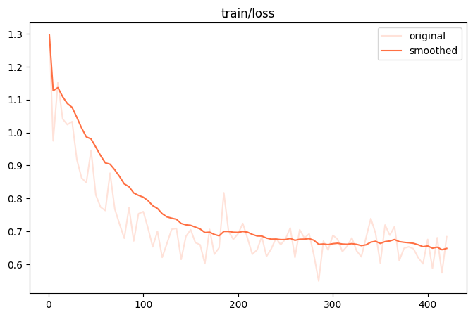
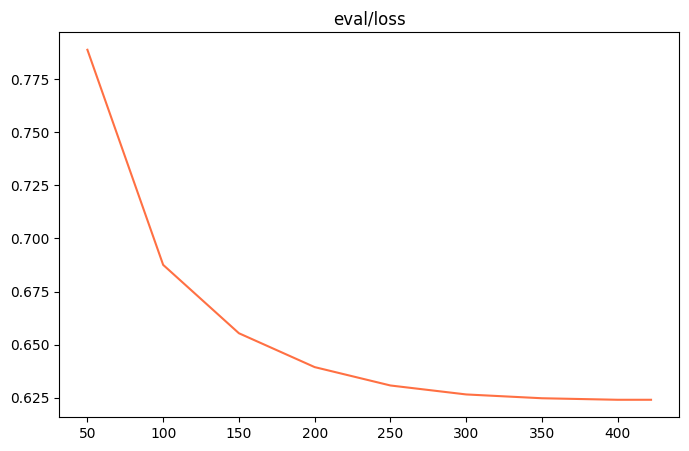
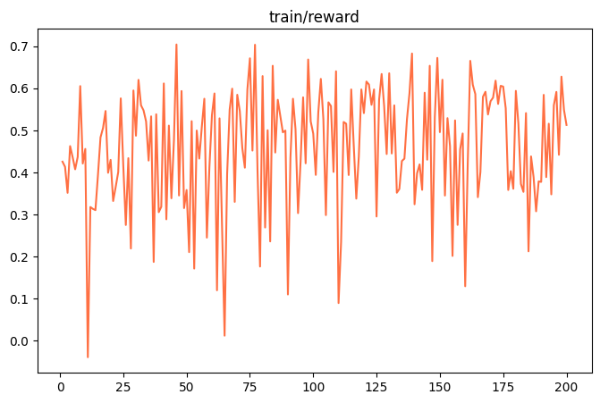
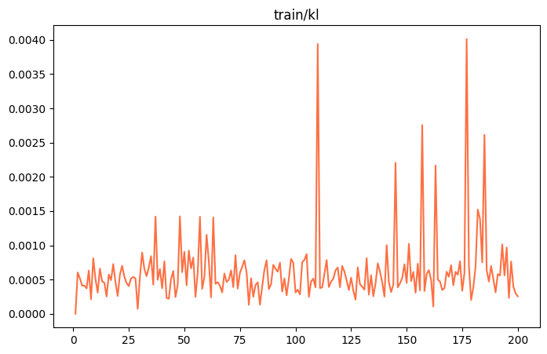
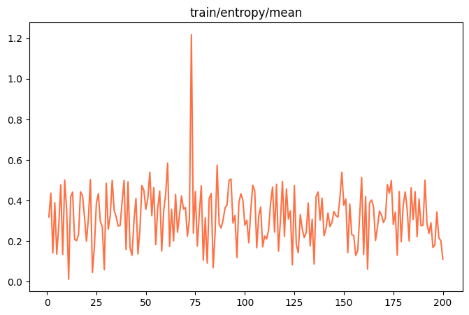
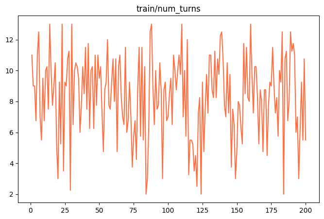
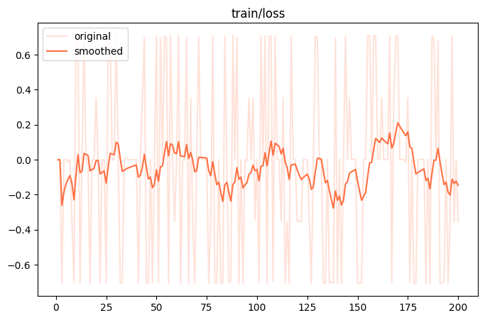

这次实验留下了三个值得放在一起看的数字：**80 对样本全部完成裁判评分，SFT 比 Base 平均高 0.2187 分；SFT 有 31/80 条样本出现同参数重复工具调用；单卡 GRPO 最终完成 200/200 步，真实进程退出码为 0。**

它们分别回答了三个问题：答案有没有变好，工具用得是否节制，训练系统能否完整运行。一个问题通过，并不意味着另外两个也通过。

这篇记录覆盖 2026 年 10 月 24—26 日的实际运行。项目的数据构建与整体设计见[之前的完整复盘](/posts/travel-agentic-rl-project-retrospective/)。这里集中记录新实验、真实故障和结果边界。服务器最终状态核对时间为 **10 月 26 日 12:23，Asia/Shanghai**；文中的 200 步曲线是本次运行结束后的静态快照。

## 1. 这次到底测了什么

Base 使用 `Qwen/Qwen3-4B-Instruct-2507`。SFT 对比使用 `checkpoint-400` 合并后的模型，RL 也从这个 SFT 模型出发，继续训练 LoRA。

| 项目 | 本次设置 |
| --- | --- |
| Base/SFT 测试集 | `data/final/test_final.jsonl`，80 条唯一问题 |
| 推理后端 | Transformers，BF16 |
| 对话上限 | 13 轮，系统工具预算配置为 13 |
| 单轮最大生成 | 5000 个新 token |
| 采样 | temperature 0.2，top_p 0.95，top_k 50 |
| 随机种子 | 同一题两模型均使用 `42 + sample_idx` |
| 裁判 | 请求模型 `deepseek-v4-flash`，服务预检返回别名 `deepseek-flash` |
| 评分方式 | 交换 A/B 顺序做双向评审，并提供实际工具返回作为证据 |

“13 轮”和“最多执行 13 个工具”不能直接画等号。一轮可以包含多个工具调用，后面的案例确实出现了 13 轮执行 24 次工具的情况。判断实际调用量要看事件日志。

工具链有八个工具。火车票和机票工具仍由大模型模拟数据，不能用于证明真实班次、票价或余票正确；其他工具接入搜索、网页访问、地图及天气等服务。模型生成了完整答案，也需要继续核对答案是否忠于工具证据。

另外，这轮 Base 和 SFT 在同一张 GPU 上并行运行，用于缩短整体等待时间。日志中的耗时包含资源竞争与外部 API 等待，不能拿来当两个模型独立运行的速度排名。测试提示还保留原始 2026 年 4 月系统日期，而实际执行在 10 月；涉及“明天”“后天”的问题，存在日期与实时服务结果不一致的限制。

## 2. SFT 有小幅提分，训练 loss 只能说明一部分

下面两张图直接来自 Swift 保存的 SFT `images/` 目录，未经重画。



*SFT train loss。横轴为训练步数。*



*SFT eval loss。验证损失下降，但真实工具任务仍需要单独评测。*

独立的 80 题对比结果如下。所有 80 对都纳入评分，包括没有生成有效最终答案的记录，没有只取双方成功的交集。

| 指标 | Base | SFT400 |
| --- | ---: | ---: |
| 裁判平均分 | 6.6206 | 6.8394 |
| 逐题获胜数 | 37 | 42 |
| 有效最终答案 | 77/80 | 78/80 |

另有 1 对平局。汇总文件记录的逐题平均差为 **+0.2187**；不要用已经四舍五入的两个均分重新相减，替换原始统计量。裁判错误数为 0，表示本轮评审请求及解析完整完成，不表示裁判判断绝对正确。

在这套题、这套裁判和本次工具条件下，SFT 略占优势。目前没有做置信区间或显著性检验，也没有多次重复采样，所以我把它记为“小幅提分”，不把这 80 题当作已经证明稳定泛化的证据。

还要留意一个口径差异：运行进度曾显示 SFT 有 79 条 `status=answer`；最终评价进一步排除了缺失 answer 标记或空答案，得到有效最终答案 **78 条**。看汇总时应使用最终评估口径。

## 3. 重复工具调用仍然存在，而且比 Base 更多

我重新核查了完整工具事件和保存的 assistant 消息。严格重复的定义是：**同一题、同一工具名、相同 JSON 参数，忽略对象键顺序。** 不同地点、日期等不同参数不会被合并；近义搜索也不会被这个统计自动识别。

| 指标 | Base | SFT400 |
| --- | ---: | ---: |
| 样本数 | 80 | 80 |
| 有完全同参重复的样本 | 5 | 31（38.75%） |
| 同一请求调用至少 3 次的样本 | 0 | 14 |
| 实际工具调用总数 | 473 | 915 |
| 超出首次的同参重复调用 | 9 | 172 |
| 用到第 13 轮的样本 | 10 | 30 |

SFT 的 172 次同参重复，占其全部 915 次调用的 **18.80%**。调用总数取每次执行的 start 事件，避免把 start 和 end 算成两次；再使用原解析器解析保存的 assistant 消息，915 次总调用及逐题计数均吻合。

一个典型问题是“明天郑州到哈尔滨高铁和飞机哪个更快”（`sample_idx=18`）。模型以相同参数调用火车票工具 12 次、机票工具 12 次，共 24 次；超出各自首次的重复有 22 次，直到第 13 轮才给出答案。昆明到南宁的另一个问题也出现了相同模式。

当前防循环保护要求连续轮次同时满足两个条件：整轮调用签名相同，整轮工具返回文本也相同。票务工具采用模型模拟，每个工具的 12 次请求分别产生了 12 种返回文本，所以即使参数没变，也绕过了这个保护条件。最后由接近轮数上限的强制回答提示收尾。

还有一种更隐蔽的情况：天津到福州的票价比较，在本轮只查了火车票、机票各一次，却继续搜索 10 次。搜索词不断增加“2026 年”“详细”“价格表”“价格对比表”等字样。这条没有计入上面 31 条严格重复样本，仍然表现出反复查询、不及时收尾。

这些统计是排查标记，不能据此认定每次重试都没有必要：失败后的合理重试需要保留。但结果已经足够说明，**答案评分的提升没有伴随工具效率的提升**。本轮完成的是核查，尚未把同参缓存、重试预算及近义查询识别改进写入推理流程，也没有声称重复问题已经修复。

## 4. 第一次 RL 失败：16384 上下文被用完

最初的报错来自这条链路：多轮对话持续累积 → Swift 算出下一轮剩余生成空间为 0 → 把 `max_tokens=0` 交给 vLLM → vLLM 拒绝请求。

16384 是这次运行配置的总上下文窗口，里面需要同时容纳系统提示、用户问题、历史回答、工具调用、工具返回和新生成文本。它不是“每一轮都能再写 16384 个 token”。

处理时做了两层修正。

**先修正 RL 输入。** 原始 `rl.jsonl` 保存的是教师的完整轨迹，而 Swift 的该条 GRPO 入口只移除最后一条 assistant，导致之前的教师工具历史也进入了新 rollout。真实分词检查发现，200 条完整历史中有 31 条超过 16384，最长 42447。一次失败的输入达到 24187 token；同一条数据只保留系统提示与原始问题后，实际只有 1231 token。

启动器现在生成独立的 `rl_prompts.jsonl`，保留全部 200 条 ID、系统提示和原始问题。教师轨迹不再作为探索起点，原始数据和参考答案仍保留给奖励评委使用。处理后初始输入为 **1217—1292 token**。

**再管理多轮预算。** 每次真实生成前，使用当前 Swift 模板精确编码，预留 2048 token 给回答，另留 128 token 安全余量：

```text
16384 总窗口 − 2048 回答预留 − 128 安全余量 = 14208 输入预算
```

空间不足时，只缩短本轮新增的工具文本并标记截断，保留历史 assistant、调用 JSON、call ID 以及训练使用的 token/mask。接近上限时给模型一次基于已有信息收尾的机会；仍然请求工具或无法容纳最低输入时，以 `context_limit` 明确结束轨迹。这里没有把 0 随便改成 1，也没有通过静默删训练样本绕过问题。

这解决了本轮遇到的预算与数据入口问题。它不会自动改善模型对证据的理解，也不会替代前面 SFT 推理链路的防重复策略。

## 5. 第二次 RL 失败：训练结束后仍然 SIGSEGV

另一次运行已经完成 3/3 步、保存 `checkpoint-3`，并打印 Swift main 结束时间，随后 Python 退出时收到 `SIGSEGV`，进程返回 `-11`。这和上下文超限是两个不同故障。

当时环境为 PyTorch **2.8.0+cu128**、vLLM **0.11.0**、Transformers **5.5.4**、ms-swift **4.2.0.dev0**。排查不能只停在日志末尾的“未调用 destroy_process_group”警告：一个仅分配约 2 MiB 显存的 CuMem 内存池实验，不加载模型、不运行 NCCL，也能复现退出崩溃。

对照实验把问题缩小到本地 vLLM 版本的资源生命周期：内存池依赖的分配器可能先被销毁；完整引擎还有缓存保留模型与 KV 对象。处理包括保留分配器引用、先释放依赖它的内存池，清理持有模型的缓存，并在保存训练状态后显式关闭引擎和通信组。

CUDA Graph 路径的对象残留在真实检查中仍未通过，所以本次单卡入口使用 **eager 模式**，同时保留 LoRA、同卡 rollout 和 sleep 机制。这是针对当前版本组合的实际取舍，不能外推成所有版本的通用修复。

修复后，真实三步验证退出码为 0，保存了优化器和调度器状态，504 个 LoRA 张量全部可读取且为有限值。没有使用 `os._exit(0)`，也没有把异常退出包装成成功。之后才进入完整 200 步运行。

原版 `train_rl.sh` 使用独立 rollout 服务，默认拓扑与这次同卡 sleep 内存池不同；不能据此认定它一定会遇到相同崩溃。单卡验证也不能替代原版多卡 GPU 训练验收。

## 6. 单卡 GRPO 最终完成 200 步

正式运行标识是 `run-20261025_174212-58421 / v0-20261025-174235`。使用 NVIDIA RTX 6000D，`nvidia-smi` 显示总显存 85651 MiB。实际保存的核心配置如下。

| 配置 | 值 |
| --- | --- |
| 初始模型 | SFT checkpoint-400 merged |
| 更新方式 | LoRA，rank 32，BF16 |
| rollout | vLLM colocate，eager，sleep level 1 |
| 最大上下文 / 单次生成 | 16384 / 2048 token |
| 最大轮数 | 13 |
| 每题生成数 / generation batch | 2 / 2 |
| 梯度累积 | 2 |
| 初始学习率 | 1e-6 |
| RL 问题数 / 总更新步数 | 200 / 200 |

截至核对时，结构化日志有 **200 条更新记录**，最后一条为 `200/200`；`trainer_state.json` 的 global_step 为 200，清理标记为完成，外层记录的真实退出码为 **0**。`checkpoint-200` 中存在 adapter、优化器、学习率调度器和随机状态文件；adapter 文件大小为 264,308,896 字节。

本次训练报告耗时 **46027.8869 秒，约 12 小时 47 分 8 秒**。这个时间包含多轮生成及工具等待，不是单纯的反向传播耗时。200 步 checkpoint 核对了保存文件和训练状态；前述“504 个张量全部有限”的逐张量检查属于三步验证，不能直接移用成 200 步权重的检查结论。

最后一次更新记录：

| 指标 | 第 200 步 |
| --- | ---: |
| loss | -0.35386199 |
| reward | 0.51300001 |
| KL | 0.00025583 |
| entropy/mean | 0.11201324 |
| grad_norm | 0.0930235 |
| learning_rate | 0 |

整体 `train_loss` 汇总为 -0.05008117，与最后一步 loss 是不同统计量。GRPO 的策略优化目标也不能和 SFT 交叉熵直接比大小；看到负数本身不足以判断训练有问题。最后学习率为 0，需要结合本次调度结束位置理解，不代表此前 200 步一直没有更新。

## 7. 曲线和奖励分解应该怎样读

下面的图全部来自这次 200 步运行的 Swift `images/`，不是三步 smoke test，也不是更早的失败运行。



*Reward 波动明显，没有呈现单调上涨；最后一个值不能代替整段训练表现。*



*KL 用于观察策略相对参考模型的偏移。数值较小不能单独证明行程事实正确。*



*Entropy 在训练中有波动和尖峰，需要与生成轨迹、奖励及工具行为共同检查。*



*轮数能帮助发现长链路，但精确重复率仍须从调用参数与事件日志计算。*



*GRPO loss。它与上面的 SFT loss 对应不同目标，不能横向用绝对值比较优劣。*

第 38 步日志里还有一组容易误读的数据。`0` 到 `5` 对应六项奖励权重，当时为 `[0.05, 0.05, 0.05, 0.05, 0.10, 0.70]`，并不是六个样本各自得了这些分。

| 分项 | 当时的分项均值 | 权重 | 加权贡献 |
| --- | ---: | ---: | ---: |
| process_step | 0.30 | 0.05 | 0.0150 |
| tool_schema | 0.25 | 0.05 | 0.0125 |
| answer_tag | 0.05 | 0.05 | 0.0025 |
| stage_aware | 0.30 | 0.05 | 0.0150 |
| tool_efficiency | 0.30 | 0.10 | 0.0300 |
| llm_judge | 0.45 | 0.70 | 0.3150 |
| 合计 | — | 1.00 | **0.3900** |

因此 `mixed_reward_mean=0.38999999999999996` 是这次加权和的浮点表示。`llm_judge=0.45` 不能解释成“45% 正确率”，训练混合奖励也不能与独立 80 题裁判的 6.8394 分直接比较。课程权重随阶段变化，跨阶段看 reward 时还要检查权重；单看 `tool_efficiency` 的聚合值也无法替代同参、近义重复的独立核查。

## 8. 日志、动态图和静态图片分别在哪里

这次把训练指标和 GPU 指标放进同一个看板，支持自动跟随最新 RL 运行。网页每 5 秒刷新，并不意味着每 5 秒产生一个训练点：loss、reward 等通常在一次更新结束后才落盘，工具请求较慢时，首点需要等几分钟。

看板显示旧运行时，先核对当前数据路径、运行 ID、日志更新时间和 global_step。`grpo_single_gpu` 是父目录，选择框实际列出的是其中每个 `run-... / v0-...`，不一定出现一个单独叫 `grpo_single_gpu` 的选项。

在项目根目录，以下命令用于查看现有运行，不会启动训练：

```bash
RUN="$(cat saved/output/grpo_single_gpu/latest_run.txt)"
tail -f "$RUN/console.log"
find "$RUN" -name logging.jsonl -o -name 'events.out.tfevents.*' -o -path '*/images/*.png'
cat "$RUN/exit_code.txt"
```

| 文件或目录 | 主要用途 |
| --- | --- |
| `latest_run.txt` | 指向启动器最近创建的运行目录 |
| `console.log` | 完整控制台输出、工具过程与异常堆栈 |
| `logging.jsonl` | Swift 结构化训练指标 |
| `runs/` 中的事件文件 | TensorBoard 动态读取指标 |
| `images/` | Swift 生成的静态指标图，本文图片来自这里 |
| `checkpoint-*/` | 保存的 LoRA 与训练状态 |
| `rl_runtime_cleanup.json` | 显式资源清理的结果 |
| `exit_code.txt` | 外层进程结束后记录的实际退出码 |

Swift 是否生成某张图，取决于实际记录了哪个指标以及绘图流程是否完成，不能只凭“用了 Swift”就假设图片齐全。这次实际收集到 RL 31 张、SFT 15 张；TensorBoard 事件、JSONL 和图片也各有用途，静态 PNG 不会像实时页面那样持续刷新。

Base/SFT 的全部对比日志则从另一条指针查找：

```bash
EVAL_RUN="$(cat test_output/base_sft_full_latest.txt)"
tail -f "$EVAL_RUN/baseline.log" "$EVAL_RUN/sft.log"
cat "$EVAL_RUN/evaluation/summary.json"
```

逐题答案在 `baseline.jsonl`、`sft.jsonl`，调用参数及原始返回在 `*_tool_events.jsonl`，逐题评分和双向裁判原文在 `evaluation/scores.jsonl`、`evaluation/judge_raw.jsonl`。这些原始轨迹适合内部核查，发布记录时只提取必要统计，避免混入服务凭据。

## 9. 下一轮需要补上的验证

本轮证据支持两项结果：SFT400 在现有 80 题裁判评测中小幅提分；当前单卡配置能够完成 rollout、训练更新、保存和正常退出。**RL checkpoint-200 尚未与 SFT400 在同一套 80 题上完成对比，不能宣布 RL 已提升答案质量或解决重复调用。**

下一轮优先做三个实验：

1. 固定推理配置和工具条件，对 SFT400 与 RL200 做同一套完整评测，同时统计得分、有效最终答案、调用量和重复率。
2. 分开限制同参成功查询、失败重试与近义搜索，再做消融，观察能否减少无效调用而不损伤答案质量。
3. 对依赖模拟票务和相对日期的问题单独标记，逐步引入可验证数据，避免把流畅回答当作事实正确。

复核依据包括项目内的 `docs/base_sft_full_evaluation.md`、`docs/rl_context_budget.md`、`docs/rl_shutdown_cleanup.md`，以及 `test_output/sft_tool_repeat_audit_20261025/` 下的严格重复报告和解析器交叉核查。另附[本次脱敏结果摘要](experiment-summary.json)，保存核对时间、对比统计、RL 配置与最终状态，便于后续实验使用相同口径。
